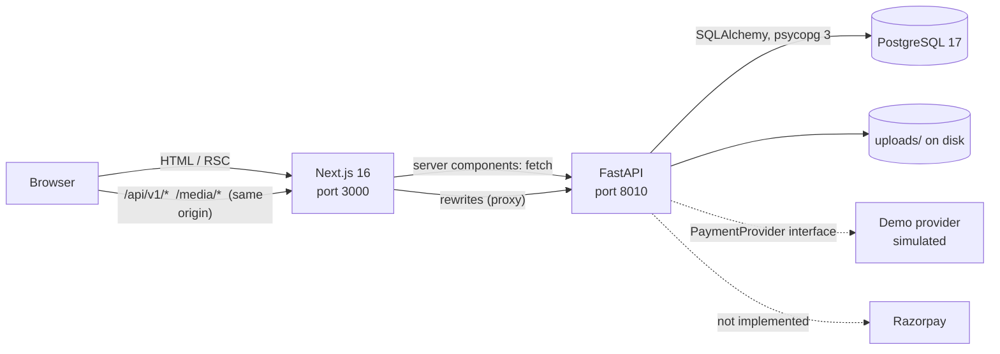
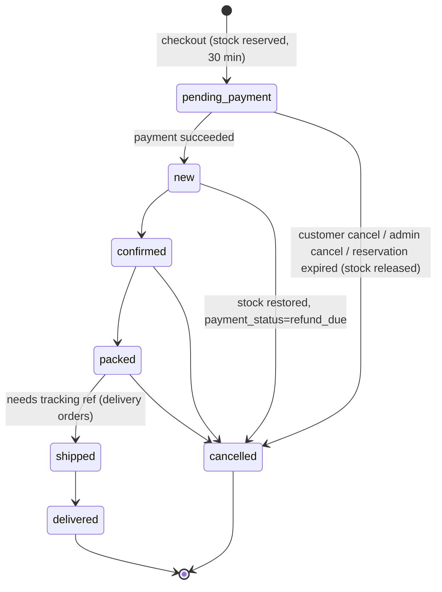

# Architecture

## 1. System



* The browser only talks to Next.js. `/api/v1/*` and `/media/*` are **rewritten** to the API, so the admin cookie is first-party (no CORS, `SameSite=Lax` works).
* Catalogue pages are server components calling the API directly (`cache: no-store`, so stock/price edits show immediately).
* Cart, checkout, payment, order and admin screens are client components calling the same-origin API.
* No Redis/queues/microservices: nothing here needs them (see §7).

## 2. Data model (PostgreSQL; all money = `BIGINT` paise)

```mermaid
erDiagram
  collections ||--o{ products : contains
  products ||--o{ product_images : has
  orders ||--|{ order_items : has
  orders ||--o{ payments : "attempts"
  orders ||--o{ order_events : "audit trail"
  products ||--o{ order_items : "snapshot of"
  collections { int id; string slug UK; string name; bool is_active; int sort_order }
  products { int id; string slug UK; string name; string category; string fabric; string color; bigint price_paise "CHECK > 0"; bigint compare_at_paise; int stock "CHECK >= 0"; bool is_active "false = archived"; bool featured }
  product_images { int id; int product_id FK; string url; string alt; int position }
  shipping_methods { int id; string code UK; bigint price_paise; bigint free_above_paise; bool requires_address; bool is_active }
  orders { int id; string reference UK; string idempotency_key UK; string status; string payment_status; bool stock_reserved; timestamptz reservation_expires_at; bigint subtotal_paise; bigint shipping_paise; bigint total_paise; string tracking_reference; text fulfilment_notes }
  order_items { int id; int order_id FK; int product_id FK; string product_name "snapshot"; bigint unit_price_paise "snapshot"; int quantity "CHECK > 0" }
  payments { int id; int order_id FK; string provider; string attempt_key "UK with order_id"; string status; bigint amount_paise; string failure_reason }
  order_events { int id; int order_id FK; string kind; string from_status; string to_status; string note; string actor }
  admin_users { int id; string email UK; string password_hash "argon2id"; bool is_active }
```

Order lines snapshot name and unit price so later catalogue edits never change history. Migration: `backend/alembic/versions/0001_initial_schema.py` (`alembic check` reports no drift from the models).

## 3. Order and payment state model



`payment_status`: `unpaid` → (`failed` ⇄ retry) → `paid`; cancelling a paid order → `refund_due`. A failed attempt sets `payment_status=failed` but **never** moves the order out of `pending_payment`, so it can never be fulfilled. Only `apply_payment_result` (one function) turns a succeeded attempt into `paid` + `new`. Fulfilment transitions additionally require `payment_status=paid`.

## 4. Key flows

**Checkout** (`POST /api/v1/checkout/orders`, optional `Idempotency-Key`):
1. Sweep expired reservations. Validate shipping method (+ address for delivery).
2. `SELECT … FOR UPDATE` the products **ordered by id** (consistent order ⇒ no deadlocks).
3. Re-check idempotency key under the lock; check active + stock for every line; collect *all* problems → `409 stock_unavailable` with details.
4. Price from the locked rows, compute shipping, decrement stock, create order + items + event; single commit. DB `CHECK (stock >= 0)` is the last line of defence; a unique `idempotency_key` plus rollback handles a racing duplicate.

**Payment** (`POST /api/v1/orders/{ref}/pay` with `email`, `attempt_key`, `demo_outcome`):
1. Lock the order row; verify email.
2. Existing attempt with the same key → return the earlier outcome (no new charge). Already `paid` → report success, charge nothing. Cancelled/not payable/expired → 409.
3. Call the provider with the **server-stored** total; record a `payments` row; `apply_payment_result`; commit.

**Admin transition** (`POST /api/v1/admin/orders/{id}/transition`): lock order, check the transition table, tracking rule and paid rule; cancel restores stock exactly once (`stock_reserved` flag); commit; audit event with the admin's email.

**Auth**: `POST /admin/auth/login` verifies an Argon2 hash (constant-time dummy hash for unknown emails), sets an httpOnly `SameSite=Lax` JWT cookie (12 h). Every admin route depends on `require_admin` (cookie → JWT → live DB check that the admin is active; mutating requests also reject a foreign `Origin`). A test enumerates every `/api/v1/admin/*` path in the OpenAPI schema and asserts 401 without a session.

## 5. Key endpoints (full, interactive docs at `/docs`)

| Method & path | Auth | Purpose |
|---|---|---|
| `GET /api/v1/products` | – | list: `q, category[], color[], collection, min_price, max_price (paise), in_stock, featured, sort, page, page_size`; returns items + facets |
| `GET /api/v1/products/{slug}` | – | detail + images + related (404 if archived) |
| `GET /api/v1/collections`, `/shipping-options` | – | collections with counts; shipping options priced for a subtotal |
| `POST /api/v1/cart/quote` | – | server pricing of `[{product_id, quantity}]`; per-line status, shipping options, totals |
| `POST /api/v1/checkout/orders` | – | create order + reserve stock (`Idempotency-Key` header) |
| `POST /api/v1/orders/lookup` | ref + email | order status/timeline (rate-limited) |
| `POST /api/v1/orders/{ref}/pay` | ref + email | demo payment attempt (`attempt_key`, `demo_outcome`) |
| `POST /api/v1/orders/{ref}/cancel` | ref + email | cancel an **unpaid** order, release stock |
| `POST /api/v1/admin/auth/login · logout`, `GET …/me` | – / cookie | session |
| `GET /api/v1/admin/dashboard` | admin | counters, low stock, recent orders |
| `GET/POST/PUT /admin/products`, `POST …/{id}/archive · restore` | admin | catalogue management |
| `GET/POST/PUT /admin/collections`, `POST …/{id}/archive · restore` | admin | collections |
| `GET /admin/orders`, `GET …/{id}`, `POST …/{id}/transition`, `PATCH …/{id}` | admin | fulfilment, notes, tracking |
| `GET/PUT /admin/shipping-methods` | admin | configurable rates |
| `POST /api/v1/admin/uploads` | admin | image upload (PNG/JPEG/WebP/GIF by magic bytes, ≤ 4 MB, UUID filename, served from `/media`) |
| `GET /health` | – | DB-checked health (503 when DB is down) |

Errors are always `{"error": {"code", "message", "details"}}`; validation failures list `details: [{field, message}]`.

## 6. Payment-provider boundary & Razorpay (not implemented)

`backend/app/services/payments.py` defines `PaymentProvider.charge(...) -> ProviderResult` and `DemoProvider`. `Settings` **rejects any `PAYMENT_PROVIDER` other than `demo`**, so the app cannot silently claim a live gateway. Nothing in this repo is integrated with Razorpay. To add it:
* Razorpay account + KYC; test then live `key_id`/`key_secret` and a webhook secret, as environment variables (never in the repo).
* `RazorpayProvider`: create a Razorpay Order (amount = server-stored paise, `receipt` = order reference); the frontend opens Razorpay Checkout (card/UPI data goes to Razorpay, never this server).
* Verify the payment signature server-side **and** handle the `payment.captured`/`payment.failed` webhooks (verified with the webhook secret) by calling `apply_payment_result` under the order lock; the browser redirect alone must not mark an order paid.
* Refunds via the Razorpay API for `refund_due` orders; add a scheduled job for reservation expiry if abandoned-checkout volume warrants it.
* Remove the demo outcome buttons and the `demo_outcome` field in live mode.

## 7. Key engineering decisions
* **Cart in the browser, pricing on the server.** A guest cart in `localStorage` needs no session table; `/cart/quote` + checkout re-price everything, so a tampered cart can't change money.
* **Reserve stock at order creation** (not at payment): prevents selling the same last saree to two people; a 30-minute window plus lazy expiry sweep (run on checkout, the admin order list and dashboard; the pay endpoint also cancels its own order if the window has lapsed) returns abandoned stock. No scheduler needed at this scale; the sweep is idempotent and `SKIP LOCKED`.
* **Pessimistic row locks + CHECK constraint** rather than optimistic retries: low contention, simplest correct behaviour, proven by concurrency tests on real PostgreSQL.
* **Same-origin proxy** instead of CORS + token storage: httpOnly cookie, no token in JS.
* **Guest order access = reference + email**, with identical 404 for both failure causes, plus rate limiting.
* **In-process rate limiter**: correct for one API instance. Multiple instances need a shared store or proxy-level limits (documented in code).
* **Illustrative SVG art generated by script**: original and licence-free; replaceable per product via admin.
* Observability: JSON logs (`order_created`, `payment_failed`, `checkout_stock_conflict`, `admin_login_failed`, `reservation_expired`, slow/5xx requests with `X-Request-ID`).
* Security headers on both servers; uploads never trusted by extension/content-type; SVG uploads refused; product image URLs must be `/`, `http://` or `https://`.
